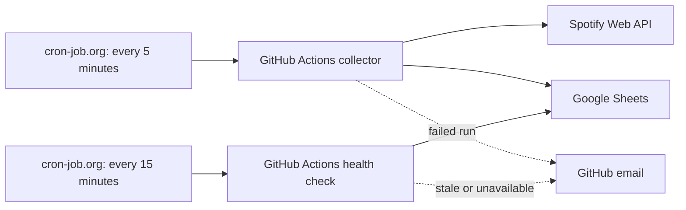

# Spotify Logger

A single-user Spotify listening-history collector. It runs in GitHub Actions, stores events and metadata in Google Sheets, and is triggered externally by cron-job.org. No public website or VPS is required. The personal portfolio/dashboard is maintained in a separate repository.



## How collection works

1. GitHub serializes collection, connection checks and health probes using the `spotify-logger-sync` concurrency group. Active writers are never cancelled by a newer run.
2. The collector reads the encrypted refresh token from `__app_state`, refreshes Spotify access, and immediately saves any rotated refresh token in the same encryption format.
3. It requests recent listening events with a two-hour overlap before the saved cursor. Spotify only exposes a limited recent history; a prolonged outage may leave gaps.
4. It reads the complete `log` and filters events by normalized timestamp, both against existing history and within the fetched batch. Repeated tracks at different timestamps are valid separate events.
5. New events are written to an explicit range after the existing rows. A lost write response is not blindly retried: the next run rereads the log, so an already committed event is skipped.
6. Track, album and artist caches are enriched with titles, cover URLs, track durations and artist genres. These records are joined by Spotify IDs, not by date.
7. Only a successful collection updates `last_sync_at` and the cursor. A run with zero new events is still a successful sync.

New `Date` values use exact UTC ISO timestamps, for example `2026-11-08T05:45:12.345Z`. The collector accepts older Moscow timestamps such as `November 8, 2026 at 8:45AM`. Since old records lost seconds, their entire minute is conservatively treated as occupied when filtering overlapping Spotify events. New ISO records preserve distinct seconds and milliseconds.

Historical duplicates are not deleted. Deduplication assumes this workflow is the **only writer**: do not run the retired collector, another repository's collector or a manual import against the same log. Do not physically sort, insert or delete log rows during a sync; use filter views. Keep the concurrency group when editing or renaming the workflow. GitHub may replace older pending runs with newer ones; runner timing is not guaranteed.

## Repository layout

```text
.github/workflows/sync.yml    Externally dispatched collector and health workflow
src/sync.ts                  Collection and metadata enrichment
src/sync-write.ts            Full-log timestamp filtering and explicit-range writes
src/sync-token.ts             Fernet/v2 credential selection and rotation
src/google.ts                Google Sheets access and app-state updates
src/spotify.ts               Spotify token refresh, recent history and artist metadata
src/sync-health.ts           Read-only freshness probe
src/crypto.ts, fernet.ts     Stored-token encryption compatibility
scripts/run-sync.mts         GitHub Actions entrypoint
scripts/authorize-spotify.mts Local Spotify OAuth callback
tests/                      Collector, crypto, date and recovery tests
```

## GitHub configuration

The workflow file must exist on the default branch (`main`). Its only trigger is `workflow_dispatch`; GitHub's native `schedule` is intentionally absent.

Under **Settings → Secrets and variables → Actions**, configure:

| Secret | Purpose |
| --- | --- |
| `GOOGLE_SERVICE_ACCOUNT_JSON` | Complete Google service-account JSON. Share this workbook with its `client_email` as Editor. |
| `USER_SHEET_ID` | ID of the listening-history workbook, not a sheet tab's `gid`. |
| `SPOTIFY_CLIENT_ID` | Spotify application client ID. |
| `SPOTIFY_CLIENT_SECRET` | Spotify application client secret. |
| `FERNET_KEY` | Existing key for `__app_state.refresh_token_enc`. This is the current setup. |
| `TOKEN_ENCRYPTION_KEY` | Optional alternative for `refresh_token_enc_v2`: a base64url-encoded 32-byte AES key. |

Use the key matching the stored authorization. When both the v2 token and its key are configured, v2 is preferred. Bad decryption does not silently fall back to another token. Never put keys, refresh tokens or service-account JSON in commits, request URLs or workflow logs.

The GitHub token used by cron-job.org is separate from these secrets. Create a fine-grained token restricted to this repository with **Actions: Read and write**. Its permission applies to repository Actions, not just this workflow. Replace it before its chosen expiration date.

## Google Sheets schema

Use an existing initialized workbook with these worksheets and columns in this order:

| Worksheet | Columns |
| --- | --- |
| `log` | `Date`, `Track`, `Artist`, `Spotify ID`, `URL` |
| `__app_state` | `key`, `value` |
| `__cache_tracks` | `track_id`, `track_name`, `duration_ms`, `album_id`, `album_cover_url`, `primary_artist_id`, `artist_ids`, `track_url`, `fetched_at` |
| `__cache_artists` | `artist_id`, `artist_name`, `artist_cover_url`, `genres`, `primary_genre`, `fetched_at` |
| `__cache_albums` | `album_id`, `album_name`, `album_cover_url`, `release_date`, `fetched_at` |

`__app_state` contains encrypted authorization, `last_synced_after_ts`, `last_sync_at`, `last_error`, `consecutive_failures` and `reauth_required`. The collector updates values without clearing unrelated state. The old `__dedupe` sheet may remain; this implementation neither requires nor writes it.

## cron-job.org tasks

Both tasks use this endpoint:

```text
https://api.github.com/repos/husaker/spotify-logger-and-vizer/actions/workflows/sync.yml/dispatches
```

Use **POST** with these headers. Leave the separate HTTP Basic Authentication switch off.

```text
Authorization: Bearer <FINE_GRAINED_GITHUB_TOKEN>
Accept: application/vnd.github+json
Content-Type: application/json
```

| Task | Interval | JSON request body |
| --- | --- | --- |
| Spotify Logger | Every 5 minutes | `{"ref":"main"}` |
| Spotify Logger Health | Every 15 minutes | `{"ref":"main","inputs":{"health_only":true}}` |

Keep both enabled. A successful HTTP dispatch means GitHub accepted the command, not that the collector succeeded. Check the corresponding Actions run for its actual result. The normal collection task should keep `health_only`, `check_only` and `test_email` false/default.

## Email alerts and health checks

In GitHub **Settings → Notifications → Actions**, select **Email** and **Only notify for failed workflows**. The account owning the dispatch token receives the run notifications according to its GitHub settings.

For **both** cron-job.org tasks, enable notification after **1 failed request**, recovery after failure and automatic deactivation. Select the account email channel. This covers rejected dispatches such as an expired GitHub token or a disabled workflow.

The independent health task only reads `__app_state`. It fails if the last successful sync is at least 30 minutes old, Spotify reauthorization is required, or state cannot be read/validated. It never calls Spotify, writes log rows, refreshes tokens or advances sync state. Missing collection is normally detected 30–45 minutes after the last success, plus runner delays.

Both checks still depend on GitHub and cron-job.org. A whole-platform outage can also interrupt the monitor; this is not an independent third-party dead-man service.

Manual workflow options:

- `check_only=true`: verify Spotify access without collecting rows or advancing sync state. A rotated token, if returned, is saved.
- `health_only=true`: check the freshness of the last successful collection.
- `test_email=true`: intentionally fail once **before** collection or API access to test GitHub email delivery. The run is clearly named `TEST`; no data changes. Leave this false for scheduled jobs.

## Local development and Spotify reauthorization

Use Node.js 24 or newer:

```sh
npm ci
npm run verify
```

`verify` runs TypeScript checking and collector tests. There is no frontend build or local web dashboard in this repository. Ordinary collection is restricted to the named GitHub workflow to preserve the single-writer guarantee.

For initial Spotify connection or later reauthorization:

1. Copy `.env.example` to ignored `.env`, fill the workbook ID, Spotify credentials and the same encryption key as GitHub. Set `GOOGLE_SERVICE_ACCOUNT_FILE` to a local service-account JSON file; inline `GOOGLE_SERVICE_ACCOUNT_JSON` is also accepted and takes priority.
2. In the Spotify application's settings, register the exact callback URL, for example `http://127.0.0.1:8766/callback`. Choose a free port. `SPOTIFY_REDIRECT_URI` must use HTTP, the explicit loopback IP `127.0.0.1` and the `/callback` path. Its default is port 8888.
3. Temporarily pause both external tasks and wait for the active collection to finish before changing authorization.
4. Run `npm run authorize`, open the printed Spotify URL and approve access. The local callback waits up to 30 minutes and saves the refresh token directly to the Sheet in encrypted form. No refresh token is printed and listening history is preserved.
5. Verify with a manual `check_only=true` workflow run, then resume both cron-job.org tasks.

If Spotify rejects a stored token as expired/revoked, repeat this local authorization flow. No publicly hosted callback is required.

## Troubleshooting

- **cron-job.org fails / Actions run never appears:** check the dispatch URL, POST method, JSON body, GitHub token expiry/Actions permission and whether the workflow is enabled on `main`.
- **Actions run fails:** open `Collect Spotify history`, then check credentials, workbook sharing and `__app_state.last_error`. Raw secrets are deliberately omitted from runner errors.
- **Health check fails:** inspect the last successful collection and `last_sync_at`; no recent listening alone is not an error. Reauthorize locally if `reauth_required` is true.
- **Cover or genre missing:** enrichment depends on Spotify metadata and cache availability; artist enrichment is limited to 25 uncached artists per run. Cached track durations are full catalog durations, not measured playback time.
- **Unexpected duplicates:** confirm there is only one collector writing this workbook. Exact-timestamp deduplication preserves repeated listens at different times; old minute-only records have lower precision.

## Retired hosting

The previous Sites application is no longer part of this flow. Its Google service-account binding and target workbook have been replaced with nonfunctional values, and its scheduled sync is disabled. Do not restore those settings or use its old admin/sync endpoints. The old deployed version and source remain in hosting/Git history for recovery; the active repository contains only this standalone collector. Shared Google credentials used by Actions and the personal portfolio were not revoked.

References: [GitHub workflow dispatch](https://docs.github.com/en/rest/actions/workflows#create-a-workflow-dispatch-event), [Actions notifications](https://docs.github.com/en/subscriptions-and-notifications/how-tos/managing-github-actions-notifications), [Spotify redirect URIs](https://developer.spotify.com/documentation/web-api/concepts/redirect_uri), [cron-job.org FAQ](https://cron-job.org/en/faq/).
